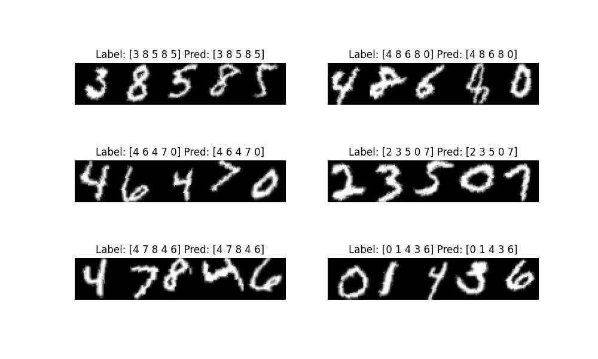
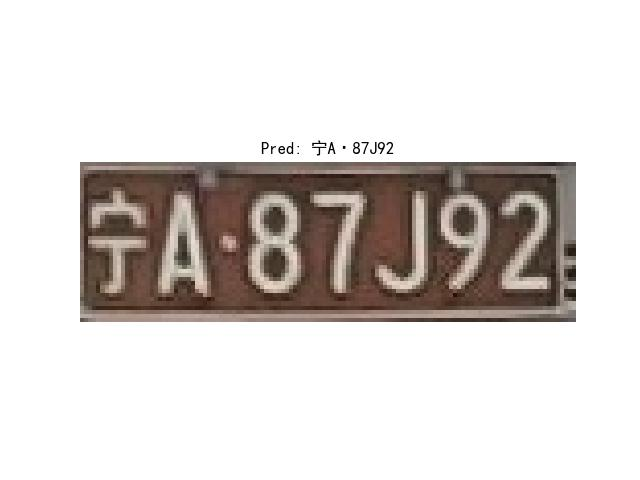
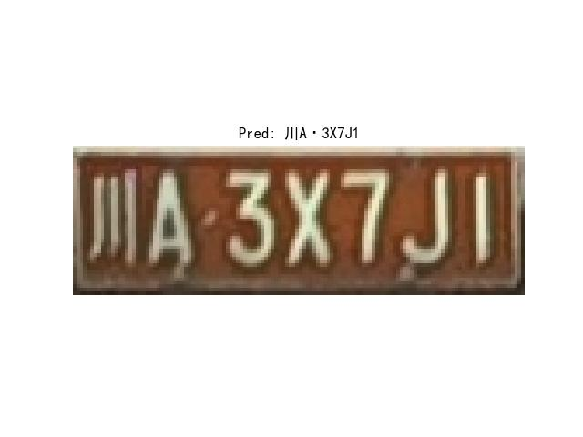

<!-- <div align="right">
  Language:
    🇺🇸
  <a title="Chinese" href="./README.zh-CN.md">🇨🇳</a>
</div> -->

<div align="center"><a title="" href="https://github.com/zjykzj/crnn-ctc"></a></div>

<p align="center">
  «crnn-ctc» implementa CRNN+CTC
<br>
<br>
  <a href="https://github.com/RichardLitt/standard-readme"></a>
  <a href="https://conventionalcommits.org"></a>
  <a href="http://commitizen.github.io/cz-cli/"></a>
</p>

DEMO EN LÍNEA: [RECONOCIMIENTO DE PLACAS](https://blog.zjykzj.cn/gradio/plate_recog/)

|   **Modelo**   | **ARQ** | **Forma de entrada** | **GFLOPs** | **Tamaño del modelo (MB)** | **Precisión EMNIST (%)** | **Datos de entrenamiento** | **Datos de prueba** |
|:-------------:|:--------:|:---------------:|:----------:|:-------------------:|:-----------------------:|:-----------------:|:----------------:|
|   **CRNN**    | CONV+GRU |  (1, 32, 160)   |    2.2     |         31          |         98.570          |      100,000      |      5,000       |
| **CRNN_Tiny** | CONV+GRU |  (1, 32, 160)   |    0.1     |         1.7         |         98.306          |      100,000      |      5,000       |

|      **Modelo**       | **ARQ** | **Forma de entrada** | **GFLOPs** | **Tamaño del modelo (MB)** | **Precisión Placas Chinas (%)** | **Datos de entrenamiento** | **Datos de prueba** |
|:--------------------:|:--------:|:---------------:|:----------:|:-------------------:|:------------------------------------:|:-----------------:|:----------------:|
|       **CRNN**       | CONV+GRU |  (3, 48, 168)   |    4.0     |         58          |                82.147                |      269,621      |     149,002      |
|    **CRNN_Tiny**     | CONV+GRU |  (3, 48, 168)   |    0.3     |         4.0         |                76.590                |      269,621      |     149,002      |
|    **LPRNetPlus**    |   CONV   |   (3, 24, 94)   |    0.5     |         2.3         |                63.546                |      269,621      |     149,002      |
|      **LPRNet**      |   CONV   |   (3, 24, 94)   |    0.3     |         1.9         |                60.105                |      269,621      |     149,002      |
| **LPRNetPlus+STNet** |   CONV   |   (3, 24, 94)   |    0.5     |         2.5         |                72.130                |      269,621      |     149,002      |
|   **LPRNet+STNet**   |   CONV   |   (3, 24, 94)   |    0.3     |         2.2         |                72.261                |      269,621      |     149,002      |

Para cada subconjunto de datos, el rendimiento del modelo es el siguiente:

|      **Modelo**       | **Precisión CCPD2019-Test (%)** | **Datos de prueba** | **Precisión CCPD2020-Test (%)** | **Datos de prueba** |
|:--------------------:|:------------------------------:|:----------------:|:------------------------------:|:----------------:|
|       **CRNN**       |             81.512             |     141,982      |             93.787             |      5,006       |
|    **CRNN_Tiny**     |             75.729             |     141,982      |             92.829             |      5,006       |
|    **LPRNetPlus**    |             62.184             |     141,982      |             89.373             |      5,006       |
|      **LPRNet**      |             59.597             |     141,982      |             89.153             |      5,006       |
| **LPRNetPlus+STNet** |             72.125             |     141,982      |             90.611             |      5,006       |
|   **LPRNet+STNet**   |             71.291             |     141,982      |             89.832             |      5,006       |

***Si deseas realizar la detección, segmentación y reconocimiento de placas simultáneamente, consulta [zjykzj/LPDet](https://github.com/zjykzj/LPDet).***

## Índice

- [/índice-de-contenidos](#índice-de-contenidos)
- [Noticias🚀🚀🚀](#noticias)
- [Antecedentes](#antecedentes)
- [Instalación](#instalación)
- [Uso](#uso)
  - [Entrenamiento](#entrenamiento)
  - [Evaluación](#evaluación)
  - [Predicción](#predicción)
- [Mantenedores](#mantenedores)
- [Agradecimientos](#agradecimientos)
- [Contribuciones](#contribuciones)
- [Licencia](#licencia)

## Noticias

| Versión                                                          | Fecha de lanzamiento | Principales Actualizaciones                                                                                                                                           |
|------------------------------------------------------------------|--------------|---------------------------------------------------------------------------------------------------------------------------------------------------------|
| [v1.3.0](https://github.com/zjykzj/crnn-ctc/releases/tag/v1.3.0) | 2024/09/21   | Se agregó el módulo **STNet** a LPRNet/LPRNetPlus y se actualizaron los resultados de entrenamiento/evaluación/predicción en el conjunto de datos CCPD.                                    |
| [v1.2.0](https://github.com/zjykzj/crnn-ctc/releases/tag/v1.2.0) | 2024/09/17   | Se creó un nuevo modelo **LPRNet/LPRNetPlus** y se actualizaron los resultados de entrenamiento/evaluación/predicción en el conjunto de datos CCPD.                                     |
| [v1.1.0](https://github.com/zjykzj/crnn-ctc/releases/tag/v1.1.0) | 2024/08/17   | Se actualizaron las implementaciones de EVAL/PREDICT, se agregó la conversión de modelos en formato PyTorch a ONNX y, finalmente se proporcionó una demo en línea basada en Gradio.                   |
| [v1.0.0](https://github.com/zjykzj/crnn-ctc/releases/tag/v1.0.0) | 2024/08/04   | Se optimizó la arquitectura CRNN mientras se lograba un **CRNN_Tiny** súper ultraligero. <br>Además, todos los scripts de entrenamiento ahora admiten entrenamiento de precisión mixta. |
| [v0.3.0](https://github.com/zjykzj/crnn-ctc/releases/tag/v0.3.0) | 2024/08/03   | Se implementaron los modelos **CRNN_LSTM** y **CRNN_GRU** en los conjuntos de datos EMNIST y Placas Chinas.                                                             |
| [v0.2.0](https://github.com/zjykzj/crnn-ctc/releases/tag/v0.2.0) | 2023/10/11   | Soporte de entrenamiento/evaluación/predicción de CRNN+CTC basado en placas.                                                                              |
| [v0.1.0](https://github.com/zjykzj/crnn-ctc/releases/tag/v0.1.0) | 2023/10/10   | Soporte de entrenamiento/evaluación/predicción de CRNN+CTC basado en dídí dígitos del conjunto de datos EMNIST.                                                                  |

## Antecedentes

Este repositorio tiene como objetivo comprender y aplicar mejor CRNN+CTC, y ha logrado actualmente el reconocimiento de dígitos y el reconocimiento de placas. Mientras tanto, LPRNet(+STNet) es una arquitectura puramente convolucional para la red de reconocimiento de placas. Creo que la implementación de estos algoritmos puede ayudar en el despliegue de algoritmos de reconocimiento de placas, como en dispositivos edge.

Los artículos relevantes incluyen:

1. [Towards End-to-End License Plate Detection and Recognition: A Large Dataset and Baseline](https://openaccess.thecvf.com/content_ECCV_2018/papers/Zhenbo_Xu_Towards_End-to-End_License_ECCV_2018_paper.pdf)
2. [An End-to-End Trainable Neural Network for Image-based Sequence Recognition and Its Application to Scene Text Recognition](https://arxiv.org/abs/1507.05717)
3. [Connectionist Temporal Classification: Labelling Unsegmented Sequence Data with Recurrent Neural Networks](https://www.cs.toronto.edu/~graves/icml_2006.pdf)
4. [LPRNet: License Plate Recognition via Deep Neural Networks](https://arxiv.org/abs/1806.10447)

Blogs relevantes (*Chino*):

1. [Towards End-to-End License Plate Detection and Recognition: A Large Dataset and Baseline](https://blog.zjykzj.cn/posts/e3db0e3d.html)
2. [An End-to-End Trainable Neural Network for Image-based Sequence Recognition and Its Application to Scene Text Recognition](https://blog.zjykzj.cn/posts/a25a6bef.html)
3. [LPRNet: License Plate Recognition via Deep Neural Networks](https://blog.zjykzj.cn/posts/c9eab5b1.html)

## Instalación

```shell
$ pip install -r requirements.txt
```

O utiliza un contenedor Docker:

```shell
$ docker run -it --runtime nvidia --gpus=all --shm-size=16g -v /etc/localtime:/etc/localtime -v $(pwd):/workdir --workdir=/workdir --name crnn-ctc ultralytics/yolov5:latest
```

## Uso

### Entrenamiento

* ChineseLicensePlate: [Baidu Drive](https://pan.baidu.com/s/1fQh0E9c6Z4satvrEthKevg)(ad7l)

```shell
# EMNIST
$ python3 train_emnist.py ../datasets/emnist/ ./runs/crnn-emnist-b512/ --batch-size 512 --device 0 --not-tiny
# Plate
$ python3 train_plate.py ../datasets/chinese_license_plate/recog/ ./runs/crnn-plate-b512/ --batch-size 512 --device 0 --not-tiny
```

### Evaluación

```shell
# EMNIST
$ CUDA_VISIBLE_DEVICES=0 python eval_emnist.py crnn-emnist.pth ../datasets/emnist/ --not-tiny
args: Namespace(not_tiny=True, pretrained='crnn-emnist.pth', use_lstm=False, val_root='../datasets/emnist/')
Loading CRNN pretrained: crnn-emnist.pth
crnn-emnist summary: 29 layers, 7924363 parameters, 7924363 gradients, 2.2 GFLOPs
Batch:49999 ACC:100.000: 100%|████████████████████████████████████████████████████████| 50000/50000 [03:47<00:00, 219.75it/s]
ACC:98.570
# Plate
$ CUDA_VISIBLE_DEVICES=0 python3 eval_plate.py crnn-plate.pth ../datasets/chinese_license_plate/recog/ --not-tiny
args: Namespace(add_stnet=False, not_tiny=True, only_ccpd2019=False, only_ccpd2020=False, only_others=False, pretrained='crnn-plate.pth', use_lprnet=False, use_lstm=False, use_origin_block=False, val_root='../datasets/chinese_license_plate/recog/')
Loading CRNN pretrained: crnn-plate.pth
crnn-plate summary: 29 layers, 15083854 parameters, 15083854 gradients, 4.0 GFLOPs
Load test data: 149002
Batch:4656 ACC:100.000: 100%|████████████████████████████████████████████████████████████| 4657/4657 [00:52<00:00, 89.13it/s]
ACC:82.147
```

### Predicción

```shell
$ CUDA_VISIBLE_DEVICES=0 python predict_emnist.py crnn-emnist.pth ../datasets/emnist/ ./runs/predict/emnist/ --not-tiny
args: Namespace(not_tiny=True, pretrained='crnn-emnist.pth', save_dir='./runs/predict/emnist/', use_lstm=False, val_root='../datasets/emnist/')
Loading CRNN pretrained: crnn-emnist.pth
crnn-emnist summary: 29 layers, 7924363 parameters, 7924363 gradients, 2.2 GFLOPs
Label: [0 4 2 4 7] Pred: [0 4 2 4 7]
Label: [2 0 6 5 4] Pred: [2 0 6 5 4]
Label: [7 3 9 9 5] Pred: [7 3 9 9 5]
Label: [9 6 6 0 9] Pred: [9 6 6 0 9]
Label: [2 3 0 7 6] Pred: [2 3 0 7 6]
Label: [6 5 9 5 2] Pred: [6 5 9 5 2]
```



```shell
$ CUDA_VISIBLE_DEVICES=0 python predict_plate.py crnn-plate.pth ./assets/plate/宁A87J92_0.jpg runs/predict/plate/ --not-tiny
args: Namespace(add_stnet=False, image_path='./assets/plate/宁A87J92_0.jpg', not_tiny=True, pretrained='crnn-plate.pth', save_dir='runs/predict/plate/', use_lprnet=False, use_lstm=False, use_origin_block=False)
Loading CRNN pretrained: crnn-plate.pth
crnn-plate summary: 29 layers, 15083854 parameters, 15083854 gradients, 4.0 GFLOPs
Pred: 宁A·87J92 - Predict time: 5.4 ms
Save to runs/predict/plate/plate_宁A87J92_0.jpg
$ CUDA_VISIBLE_DEVICES=0 python predict_plate.py crnn-plate.pth ./assets/plate/川A3X7J1_0.jpg runs/predict/plate/ --not-tiny
args: Namespace(add_stnet=False, image_path='./assets/plate/川A3X7J1_0.jpg', not_tiny=True, pretrained='crnn-plate.pth', save_dir='runs/predict/plate/', use_lprnet=False, use_lstm=False, use_origin_block=False)
Loading CRNN pretrained: crnn-plate.pth
crnn-plate summary: 29 layers, 15083854 parameters, 15083854 gradients, 4.0 GFLOPs
Pred: 川A·3X7J1 - Predict time: 4.7 ms
Save to runs/predict/plate/plate_川A3X7J1_0.jpg
```

<p align="left">  </p>

## Mantenedores

* zhujian - *Trabajo inicial* - [zjykzj](https://github.com/zjykzj)

## Agradecimientos

* [rinabuoy/crnn-ctc-loss-pytorch](https://github.com/rinabuoy/crnn-ctc-loss-pytorch.git)
* [we0091234/crnn_plate_recognition](https://github.com/we0091234/crnn_plate_recognition.git)
* [sirius-ai/LPRNet_Pytorch](https://github.com/sirius-ai/LPRNet_Pytorch)
* [CA-USTC/License_Plate_Recognition_pytorch](https://github.com/CA-USTC/License_Plate_Recognition_pytorch)
* [zjykzj/LPDet](https://github.com/zjykzj/LPDet)

## Contribuciones

¡La participación de cualquier persona es bienvenida! Abre un [issue](https://github.com/zjykzj/crnn-ctc/issues) o envía PRs.

Pequeña nota:

* Las especificaciones de envío de Git deben cumplir cumplir con
  [Conventional Commits](https://www.conventionalcommits.org/en/v1.0.0-beta.4/)
* Si se versiona, por favor conformarse a la especificación [Semantic Versioning 2.0.0](https://semver.org)
* Si editas el README, por favor conformarse a la especificación [standard-readme](https://github.com/RichardLitt/standard-readme)
  .

## Licencia

[Licencia Apache 2.0](LICENSE) © 2023 zjykzj
